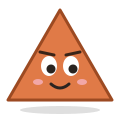

<p align="center"></p>

<h3 align="center">Hi, I'm Adharsh. I teach Windows PCs to obey.</h3>

<p align="center">
Student. Founder of <a href="https://arvatalksacademy.com">ARVA Talks Academy</a>.<br>
I'd rather an agent ask me twice than spend my money once.
</p>

### [Project Delta](https://github.com/adharshramu12/Project-Delta)

An open-source personal AI agent for Windows. It controls your PC and browser, verifies every task, and works from
Telegram. Bring your own AI: Codex, Claude Code, Groq, NVIDIA, Nebius, DeepSeek or a local model.
"Turn the volume up" costs zero tokens. AGPL-3.0.

```text
status    Delta 0.4.0, shipped in public
mascot    Tri. Delta is a triangle. It made sense at 3 am.
```

### Rules I build by

1. **Verify, don't assume.** An agent that says "done" should have checked.
2. **Ask before anything you can't undo.** Sending, paying, deleting, trading: always a yes from a human.
3. **Don't burn tokens on easy things.** If a regex can do it, the AI doesn't need to.
4. **Local first.** Your files, keys and chats stay on your machine.
